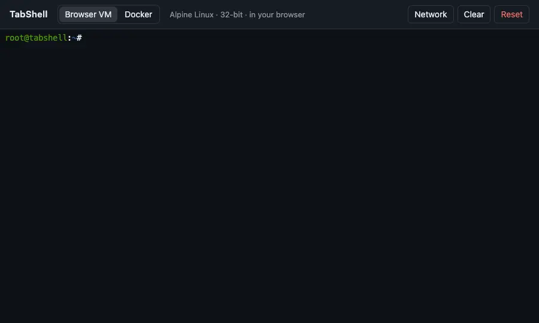

<div align="center">

# TabShell

A real Linux terminal in a browser tab. Install packages, play terminal games, then press Reset and it's as if nothing happened.

[Features](#features) · [Run it](#run-it) · [Using it](#using-it) · [How it works](#how-it-works) · [Limits](#limits) · [Contributing](#contributing)




</div>

<!-- run-steps:start -->
## Run it locally, step by step

1. **Install [Node.js](https://nodejs.org) 20** or newer and [Docker](https://www.docker.com/products/docker-desktop/).

2. **Get the code:**

   ```sh
   git clone https://github.com/Gitguy268/tabshell.git
   cd tabshell
   ```

3. **Install and build:**

   ```sh
   npm ci
   npm run image
   docker build -t tabshell-ubuntu -f docker/Dockerfile .
   npm run build
   ```

   On a Mac you can double-click `start.command` instead. It does all of this for you.

4. **Start it:**

   ```sh
   npm start
   ```

5. **Open <http://localhost:8686/>** in your browser. Press `Ctrl+C` in the terminal to stop.
<!-- run-steps:end -->

## Features

| | Browser VM | Docker |
|---|---|---|
| Linux | Alpine 3.21, 32-bit (i686) | Ubuntu 24.04, 64-bit |
| Runs in | your browser, with [v86](https://github.com/copy/v86) (an x86 emulator compiled to WebAssembly) | a Docker container on your computer |
| Needs | any modern browser | Docker Desktop or [container](https://github.com/apple/container), and `start.command` |
| Install packages | `apk add python3` | `sudo apt install python3`, Homebrew |
| Preinstalled | Node.js, npm, [snek](https://github.com/taniarascia/snek), podman, `spf`\*, `container`\* | git, curl, build tools, podman, `spf`\*, `opencode`\*, `container`\* |
| Kept until Reset | yes, saved in your browser (IndexedDB) | yes, the container stays until Reset |

\* Built from the [superfile](https://github.com/yorukot/superfile), [opencode](https://github.com/anomalyco/opencode) and [container](https://github.com/apple/container) forks when they're checked out next to TabShell (`../superfile`, `../opencode`, `../container`); `scripts/build-tools.sh` skips any that are missing. `container` on Linux is the fork's podman front-end (`docs/linux.md` in the container fork): `container run --rm alpine echo hi`, `container ls -a`, `container here alpine sh`.

Both modes share one terminal: [xterm.js](https://github.com/xtermjs/xterm.js) drawing on the GPU through its WebGL renderer, with resize, colours, mouse and full-screen programs. The header's theme menu switches the terminal and page between Default, Nujabes and Ye: Graduation, and remembers your choice. The two named themes also show a line of text in the header. They are unofficial tributes; see [NOTICE](NOTICE).

- **Reset** throws the machine away and starts a fresh one: files, packages, history and the screen.
- **Clear** only clears the screen.
- **Network** sets the relay the Browser VM uses to reach the internet.

## Run it

**On a Mac:** download or clone this repository and double-click **`start.command`**. It:

- starts Docker Desktop;
- builds what's missing (the first run takes a few minutes);
- serves TabShell on <http://localhost:8686>;
- opens it in your browser.

Close the Terminal window to stop it. If macOS says it can't open `start.command` because it was downloaded from the internet, right-click it and choose **Open** once.

Opening `index.html` directly doesn't work. Browsers won't run the app from a `file://` address.

**Anywhere else**, with Node.js 20+ and Docker:

```sh
npm ci
./scripts/build-tools.sh                # optional: spf, opencode, container from ../ checkouts
npm run image                           # Alpine VM image → public/alpine/
docker build -t tabshell-ubuntu -f docker/Dockerfile .  # Ubuntu image for Docker mode
npm run build
npm start                               # http://localhost:8686
```

Without Docker running, only Browser VM mode works. The Alpine image is built with Docker, so that first step needs it once, or a copy of `public/alpine/` from a build.

## Using it

**Browser VM.** It boots in about 30 seconds the first time. After that it restores where you left off.

```sh
apk add python3        # about 30 s through the default relay
python3
snek                   # arrow keys to steer, Esc or q to quit
```

**Docker** mode is Ubuntu, logged in as `dev` with passwordless `sudo`:

```sh
sudo apt update && sudo apt install -y python3
/bin/bash -c "$(curl -fsSL https://raw.githubusercontent.com/Homebrew/install/HEAD/install.sh)"
eval "$(/home/linuxbrew/.linuxbrew/bin/brew shellenv)"
brew install node
git clone https://github.com/taniarascia/snek && cd snek && npm i && npm run play
```

Switching modes keeps both machines. Each one is only wiped by its own Reset.

## How it works

```
browser: xterm.js + WebGL renderer
 ├─ Browser VM: v86 (WebAssembly) ─ Alpine on a 9p filesystem ─ virtio console
 │                  └─ network: Wisp relay over a WebSocket
 └─ Docker:     server.mjs (127.0.0.1:8686) ─ WebSocket proxy ─ ttyd ─ bash in Ubuntu (Docker or apple/container)
```

<details>
<summary><b>Browser VM details</b></summary>

- **Image.** `scripts/build-image.sh` builds an i386 Alpine container from `image/Dockerfile` and exports its filesystem. v86's `fs2json.py` and `copy-to-sha256.py` then turn it into `public/alpine/`: a JSON index plus one zstd-compressed file per file. The VM downloads files only when it reads them.
- **Boot.** The kernel and initramfs are read from that filesystem. The kernel uses `hvc0` (virtio console) as its console, and getty logs in as root there.
- **Terminal.** Bytes go between xterm.js and the virtio console. Terminal size reaches the guest as virtio resize messages, so `stty size` and full-screen programs follow the window.
- **Saving.**
  - What's saved: the whole machine (memory, devices and changed files), using `save_state()`.
  - Where: IndexedDB.
  - When: 5 seconds after the screen goes quiet, every minute during nonstop output such as a game, and when the tab is hidden. Changes from the last few seconds before closing the tab can be lost.
  - On the next visit, the VM continues from that state. Its clock is re-synced over NTP within a minute.
- **Reset.** Stops the VM, deletes the saved state and boots the original image.
- **Network.** The VM's virtio network card talks to a relay over a WebSocket.
  - **Default:** Mercury Workshop's public Wisp server `wisps://wisp.mercurywork.shop/v86/`, the same one v86's own demo offers.
  - **Speed:** in testing, `apk add python3` took about 30 s.
  - **Older relay:** `wss://relay.widgetry.org/` also works but was about 35 KB/s.

</details>

<details>
<summary><b>Docker mode details</b></summary>

- `docker/Dockerfile` is Ubuntu 24.04 with ttyd, sudo and Homebrew's prerequisites. Python and Homebrew are left for you to install.
- `server.mjs` uses only Node's standard library. It:
  - creates the container `tabshell-linux` the first time it's needed;
  - starts it again later;
  - removes and recreates it on Reset;
  - attaches no volumes or bind mounts, so removing the container removes everything.
- The page talks ttyd's WebSocket protocol through `server.mjs`.
- **Without Docker.** When Docker doesn't answer but `container system status` does, the same image runs on [apple/container](https://github.com/apple/container) instead: `start.command` builds it with `container build`, and the proxy reaches ttyd on the container VM's own address rather than a forwarded port.

**Security.** A local shell is a tempting target for other websites, so:

- the server listens on `127.0.0.1` only;
- it refuses any `Host` header other than `localhost:8686` or `127.0.0.1:8686`, which stops DNS rebinding;
- it refuses a `POST` or WebSocket from any other page's origin;
- it sends no CORS headers;
- ttyd is published on `127.0.0.1:8687` (on apple/container: the VM's private vmnet address, reachable only from this Mac and its VMs) and needs a random per-container password, which the proxy adds;
- the container runs without the Docker socket and without access to your files. It is `--privileged` (all capabilities on apple/container) so podman can run containers inside it, which gives its shell root over Docker's Linux VM.

</details>

<details>
<summary><b>The terminal projects this was built from</b></summary>

- **Used directly:** [xterm.js](https://github.com/xtermjs/xterm.js), [v86](https://github.com/copy/v86) and [ttyd](https://github.com/tsl0922/ttyd), the last inside the container.
- **Considered but not used:**
  - [node-pty](https://github.com/microsoft/node-pty): ttyd already provides the PTY, so no native module is needed.
  - [Hyper](https://github.com/vercel/hyper), [Rio](https://github.com/raphamorim/rio) and [Termux](https://github.com/termux/termux-app): desktop and Android apps.
  - [terminal.js](https://github.com/Gottox/terminal.js), [WebTerm](https://github.com/minie4/WebTerm) and [tehckisnow/terminal](https://github.com/tehckisnow/terminal).

</details>

## Limits

- **No Homebrew in Browser VM.** v86 emulates a 32-bit PC, and Homebrew only supports 64-bit Linux. Use Docker mode for Homebrew.
- **Browser VM speed.** It's an emulator: plain shell work is fine, while compiling or installing large packages is slow.
- **Containers in the Browser VM.** Images live in the VM's 512 MB of memory and share its network, so small images like `alpine` work and big ones don't fit.
- **Relay.** The Browser VM's internet traffic goes through a third-party relay unless you run your own. See **Network** in the app.
- **Docker mode is local.** It isn't available on the hosted page, only through `start.command` or `npm start`.
- **Shells after a reload.** Reloading in Docker mode starts a new shell. Files and packages stay, but programs running in the old shell are stopped.
- **Image updates.** When a new version of TabShell ships a changed Linux image, a VM saved on the old image can't be restored and you get a fresh one.
- **Browser storage.** A saved Browser VM is about 150 MB with Python installed, and grows with what you add. Clearing the site's data in your browser has the same effect as Reset.

## Contributing

See [CONTRIBUTING.md](CONTRIBUTING.md). Report security problems privately as described in [SECURITY.md](SECURITY.md). By taking part you agree to the [Code of Conduct](CODE_OF_CONDUCT.md).

## License

[MIT](LICENSE) © Lucas Van De Weerd. Third-party software and its licences are listed in [NOTICE](NOTICE). TabShell isn't affiliated with any of the projects it uses.
