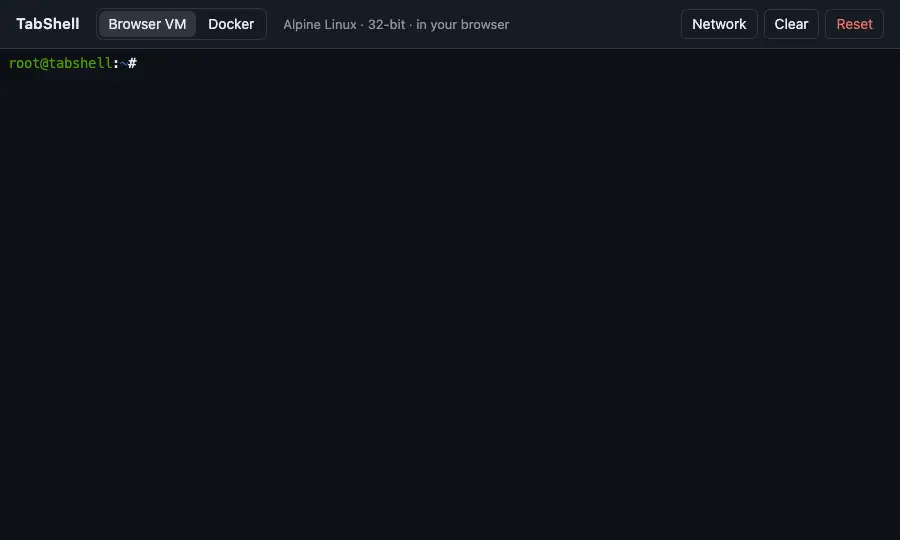
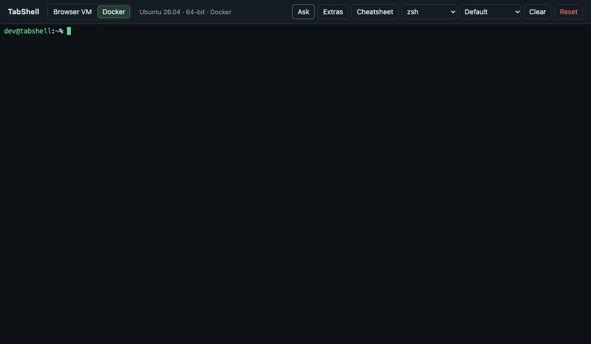
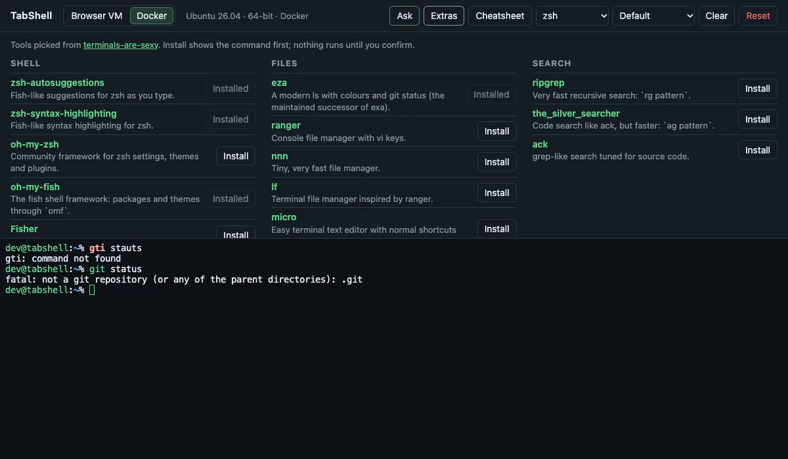

<div align="center">

# TabShell

A real Linux terminal in a browser tab. Install packages, play terminal games, then press Reset and it's as if nothing happened.

[Features](#features) · [Ask](#ask-commands-in-plain-english) · [Run it](#run-it) · [Using it](#using-it) · [How it works](#how-it-works) · [Limits](#limits) · [Contributing](#contributing)




</div>

<!-- live-links -->
**Live:** [gitguy268.github.io/tabshell](https://gitguy268.github.io/tabshell/) · [tabshell.vercel.app](https://tabshell.vercel.app)
<!-- /live-links -->

## Install with Homebrew

```sh
brew trust gitguy268/tap
brew install gitguy268/tap/tabshell
tabshell
```

Then open <http://localhost:8686/>. The browser VM works right away; for Docker mode, start Docker and run `tabshell docker-image` once.

<!-- run-steps:start -->
## Run it locally, step by step

1. **Install [Node.js](https://nodejs.org) 20** or newer and [Docker](https://www.docker.com/products/docker-desktop/).

2. **Get the code:**

   ```sh
   git clone https://github.com/Gitguy268/tabshell.git
   cd tabshell
   ```

3. **Install and build:**

   ```sh
   npm ci
   npm run image
   docker build -t tabshell-ubuntu -f docker/Dockerfile .
   npm run build
   ```

   On a Mac you can double-click `start.command` instead. It does all of this for you.

4. **Start it:**

   ```sh
   npm start
   ```

5. **Open <http://localhost:8686/>** in your browser. Press `Ctrl+C` in the terminal to stop.
<!-- run-steps:end -->

## Features

| | Browser VM | Docker |
|---|---|---|
| Linux | Alpine 3.24, 32-bit (i686) | Ubuntu 26.04, 64-bit |
| Runs in | your browser, with [v86](https://github.com/copy/v86) (an x86 emulator compiled to WebAssembly) | a Docker container on your computer |
| Needs | any modern browser | Docker Desktop or [container](https://github.com/apple/container), and `start.command` |
| Shells | ash (default), bash, zsh, fish with [oh-my-fish](https://github.com/oh-my-fish/oh-my-fish) | bash (default), zsh, fish with oh-my-fish |
| Install packages | `apk add python3` | `sudo apt install python3`, Homebrew |
| Preinstalled | Node.js, npm, git, [snek](https://github.com/taniarascia/snek), podman, fzf, zoxide, eza, `spf`\*, `container`\* | git, curl, build tools, podman, fzf, zoxide, eza, `spf`\*, `opencode`\*, `container`\* |
| Kept until Reset | yes, saved in your browser (IndexedDB) | yes, the container stays until Reset |

\* Built from the [superfile](https://github.com/yorukot/superfile), [opencode](https://github.com/anomalyco/opencode) and [container](https://github.com/apple/container) forks when they're checked out next to TabShell (`../superfile`, `../opencode`, `../container`); `scripts/build-tools.sh` skips any that are missing. `container` on Linux is the fork's podman front-end (`docs/linux.md` in the container fork): `container run --rm alpine echo hi`, `container ls -a`, `container here alpine sh`.

Both modes share one terminal: [xterm.js](https://github.com/xtermjs/xterm.js) drawing on the GPU through its WebGL renderer, with resize, colours, mouse and full-screen programs. The header's theme menu switches the terminal and page between Default, Light, Nujabes and Ye: Graduation, or follows your system's light or dark setting, and remembers your choice. Every theme has a full 16-colour palette that the tests check for readable contrast. The two named themes also show a line of text in the header; with Ye: Graduation, click it for another. They are unofficial tributes; see [NOTICE](NOTICE).

- **Ask** (or `Ctrl+Shift+Space`) turns plain English or a mistyped command into a command you confirm. See [below](#ask-commands-in-plain-english).
- **Extras** lists tools from [terminals-are-sexy](https://github.com/k4m4/terminals-are-sexy) with an Install button each. The `extras` command prints the same list.
- **Cheatsheet** shows line editing, history and file basics. The `cheat` command prints it in the terminal.
- **Shell** picks bash, zsh or fish, and remembers it. zsh comes with suggestions as you type and syntax colours; fish comes with oh-my-fish (`omf help`).
- **Reset** throws the machine away and starts a fresh one: files, packages, history and the screen.
- **Clear** only clears the screen.
- **Network** sets the relay the Browser VM uses to reach the internet.

## Ask: commands in plain English



Type what you want (`install python`, `find files bigger than 100MB`) or a command you got wrong (`gti stauts`). TabShell shows one command in an editable box, with a red warning for risky parts such as `sudo`, `rm -rf` or a script piped from the internet. **Enter** runs it, **Esc** cancels. Nothing runs on its own.

In bash, zsh and fish, a command the shell can't find opens the same box with a fix. ash, the Browser VM's default shell, has no hook for this; switch to one of the others in the Shell menu. You can turn this off under **Options**.

Answers come from three places, in this order:

1. **Recipes** for things a small model gets wrong: `install brew` (the official installer in Docker mode; in the Browser VM, a note that Homebrew needs 64-bit Linux), oh-my-fish, oh-my-zsh, `update everything`, switching shells, and every tool in Extras, with the right package name for apk or apt.
2. **Typo fixes** for command names and the subcommands of git, apt, apk, brew, npm, docker and pip.
3. **A small language model** running in your browser with [wllama](https://github.com/ngxson/wllama). It downloads the first time it's needed, after you click **Download and ask**, and stays in the browser's cache. Your words never leave the page.

<details>
<summary><b>Which model, and how it was picked</b></summary>

`scripts/assist-eval.mjs` asks each candidate 42 fixed questions: requests and typos for Alpine, Ubuntu and macOS, including `install brew` on each. It runs with llama.cpp, temperature 0. The default is the best scorer; the others can be chosen under **Options**.

| Model (GGUF, Apache-2.0) | Size | Model alone | With recipes and typo fixes | CPU time per answer* |
|---|---|---|---|---|
| [Qwen2.5-Coder 0.5B NL2Bash](https://huggingface.co/burhan2753y/qwen2.5-coder-0.5b-nl2bash-gguf) (default) | 531 MB | 35/42 | 40/42 | 97 ms |
| [Qwen2.5-Coder 0.5B Instruct](https://huggingface.co/Qwen/Qwen2.5-Coder-0.5B-Instruct-GGUF) Q4_K_M | 491 MB | 32/42 | 37/42 | 118 ms |
| [K2-Horizon 0.9B System 1](https://huggingface.co/Lucasgitguy-co/K2-Horizon-0.9B-System1-GGUF) Q4_K_M | 666 MB | 32/42 | 37/42 | 421 ms |

\* Native llama.cpp on an M4. In the browser the first answer takes about 13 s (loading), then 1 to 2 s each.

[jaredpalmer/kev-0.8b](https://huggingface.co/jaredpalmer/kev-0.8b) was considered. It's a decision model: a LoRA with a multiple-choice head that picks one of the answers it's given, so it can't write a command.

To score other models: `node scripts/assist-eval.mjs model-a.gguf model-b.gguf` (needs `llama-server`, from `brew install llama.cpp`).

</details>



## Run it

**On a Mac:** download or clone this repository and double-click **`start.command`**. It:

- starts Docker Desktop;
- builds what's missing (the first run takes a few minutes);
- serves TabShell on <http://localhost:8686>;
- opens it in your browser.

Close the Terminal window to stop it. If macOS says it can't open `start.command` because it was downloaded from the internet, right-click it and choose **Open** once.

Opening `index.html` directly doesn't work. Browsers won't run the app from a `file://` address.

**Anywhere else**, with Node.js 20+ and Docker:

```sh
npm ci
./scripts/build-tools.sh                # optional: spf, opencode, container from ../ checkouts
npm run image                           # Alpine VM image → public/alpine/
docker build -t tabshell-ubuntu -f docker/Dockerfile .  # Ubuntu image for Docker mode
npm run build
npm start                               # http://localhost:8686
```

Without Docker running, only Browser VM mode works. The Alpine image is built with Docker, so that first step needs it once, or a copy of `public/alpine/` from a build.

## Using it

**Browser VM.** It boots in about 30 seconds the first time. After that it restores where you left off.

```sh
apk add python3        # about 30 s through the default relay
python3
snek                   # arrow keys to steer, Esc or q to quit
```

**Docker** mode is Ubuntu, logged in as `dev` with passwordless `sudo`:

```sh
sudo apt update && sudo apt install -y python3
/bin/bash -c "$(curl -fsSL https://raw.githubusercontent.com/Homebrew/install/HEAD/install.sh)"
eval "$(/home/linuxbrew/.linuxbrew/bin/brew shellenv)"
brew install node
git clone https://github.com/taniarascia/snek && cd snek && npm i && npm run play
```

Switching modes keeps both machines. Each one is only wiped by its own Reset.

## How it works

```
browser: xterm.js + WebGL renderer
 ├─ Browser VM: v86 (WebAssembly) ─ Alpine on a 9p filesystem ─ virtio console
 │                  └─ network: Wisp relay over a WebSocket
 └─ Docker:     server.mjs (127.0.0.1:8686) ─ WebSocket proxy ─ ttyd ─ bash in Ubuntu (Docker or apple/container)
```

<details>
<summary><b>Browser VM details</b></summary>

- **Image.** `scripts/build-image.sh` builds an i386 Alpine container from `image/Dockerfile` and exports its filesystem. v86's `fs2json.py` and `copy-to-sha256.py` then turn it into `public/alpine/`: a JSON index plus one zstd-compressed file per file. The VM downloads files only when it reads them.
- **Boot.** The kernel and initramfs are read from that filesystem. The kernel uses `hvc0` (virtio console) as its console, and getty logs in as root there.
- **Terminal.** Bytes go between xterm.js and the virtio console. Terminal size reaches the guest as virtio resize messages, so `stty size` and full-screen programs follow the window.
- **Saving.**
  - What's saved: the whole machine (memory, devices and changed files), using `save_state()`.
  - Where: IndexedDB.
  - When: 5 seconds after the screen goes quiet, every minute during nonstop output such as a game, and when the tab is hidden. Changes from the last few seconds before closing the tab can be lost.
  - On the next visit, the VM continues from that state. Its clock is re-synced over NTP within a minute.
- **Reset.** Stops the VM, deletes the saved state and boots the original image.
- **Shells.** Both images get the same files from `image/shell/`: zsh and fish settings, the command-not-found hooks, and the `cheat` and `extras` commands (generated from `src/cheatsheet.js` and `src/extras.js` by `node scripts/gen-shell.mjs`). The first login shell sends a private escape sequence, `OSC 7777 ready;<shell>`, and the page answers by starting the shell picked in the menu. The hooks send `OSC 7777 assist;<base64 of the typed words>`, which the page reads with xterm.js's OSC handler. Other terminals ignore both.
- **Network.** The VM's virtio network card talks to a relay over a WebSocket.
  - **Default:** Mercury Workshop's public Wisp server `wisps://wisp.mercurywork.shop/v86/`, the same one v86's own demo offers.
  - **Speed:** in testing, `apk add python3` took about 30 s.
  - **Older relay:** `wss://relay.widgetry.org/` also works but was about 35 KB/s.

</details>

<details>
<summary><b>Docker mode details</b></summary>

- `docker/Dockerfile` is Ubuntu 26.04 with ttyd, sudo and Homebrew's prerequisites, plus zsh, fish and oh-my-fish. Python and Homebrew are left for you to install.
- `server.mjs` uses only Node's standard library. It:
  - creates the container `tabshell-linux` the first time it's needed;
  - starts it again later;
  - removes and recreates it on Reset;
  - attaches no volumes or bind mounts, so removing the container removes everything.
- The page talks ttyd's WebSocket protocol through `server.mjs`.
- **Without Docker.** When Docker doesn't answer but `container system status` does, the same image runs on [apple/container](https://github.com/apple/container) instead: `start.command` builds it with `container build`, and the proxy reaches ttyd on the container VM's own address rather than a forwarded port.

**Security.** A local shell is a tempting target for other websites, so:

- the server listens on `127.0.0.1` only;
- it refuses any `Host` header other than `localhost:8686` or `127.0.0.1:8686`, which stops DNS rebinding;
- it refuses a `POST` or WebSocket from any other page's origin;
- it sends no CORS headers;
- ttyd is published on `127.0.0.1:8687` (on apple/container: the VM's private vmnet address, reachable only from this Mac and its VMs) and needs a random per-container password, which the proxy adds;
- the container runs without the Docker socket and without access to your files. It is `--privileged` (all capabilities on apple/container) so podman can run containers inside it, which gives its shell root over Docker's Linux VM.

</details>

<details>
<summary><b>The terminal projects this was built from</b></summary>

- **Used directly:** [xterm.js](https://github.com/xtermjs/xterm.js), [v86](https://github.com/copy/v86) and [ttyd](https://github.com/tsl0922/ttyd), the last inside the container.
- **Considered but not used:**
  - [node-pty](https://github.com/microsoft/node-pty): ttyd already provides the PTY, so no native module is needed.
  - [Hyper](https://github.com/vercel/hyper), [Rio](https://github.com/raphamorim/rio) and [Termux](https://github.com/termux/termux-app): desktop and Android apps.
  - [terminal.js](https://github.com/Gottox/terminal.js), [WebTerm](https://github.com/minie4/WebTerm) and [tehckisnow/terminal](https://github.com/tehckisnow/terminal).

</details>

## Limits

- **No Homebrew in Browser VM.** v86 emulates a 32-bit PC, and Homebrew only supports 64-bit Linux. Use Docker mode for Homebrew.
- **Browser VM speed.** It's an emulator: plain shell work is fine, while compiling or installing large packages is slow.
- **Containers in the Browser VM.** Images live in the VM's 512 MB of memory and share its network, so small images like `alpine` work and big ones don't fit.
- **Relay.** The Browser VM's internet traffic goes through a third-party relay unless you run your own. See **Network** in the app.
- **Docker mode is local.** It isn't available on the hosted page, only through `start.command` or `npm start`.
- **Shells after a reload.** Reloading in Docker mode starts a new shell. Files and packages stay, but programs running in the old shell are stopped.
- **The assistant** is a 0.5B model. It can be wrong, which is why every answer waits for you. It needs about 600 MB of browser storage and memory while loaded.
- **Shell switching** types `exec zsh -l` (or bash, fish) into the terminal, so it replaces whatever shell is at the prompt.
- **Image updates.** When a new version of TabShell ships a changed Linux image, a VM saved on the old image can't be restored and you get a fresh one. `start.command` notices changed image sources and rebuilds both images. Your Docker-mode container keeps running the old image until you press **Reset** in Docker mode. With Homebrew, run `tabshell docker-image` again after upgrading.
- **Browser storage.** A saved Browser VM is about 150 MB with Python installed, and grows with what you add. Clearing the site's data in your browser has the same effect as Reset.

## Contributing

See [CONTRIBUTING.md](CONTRIBUTING.md). Report security problems privately as described in [SECURITY.md](SECURITY.md). By taking part you agree to the [Code of Conduct](CODE_OF_CONDUCT.md).

## License

[MIT](LICENSE) © Lucas Van De Weerd. Third-party software and its licences are listed in [NOTICE](NOTICE). TabShell isn't affiliated with any of the projects it uses.
